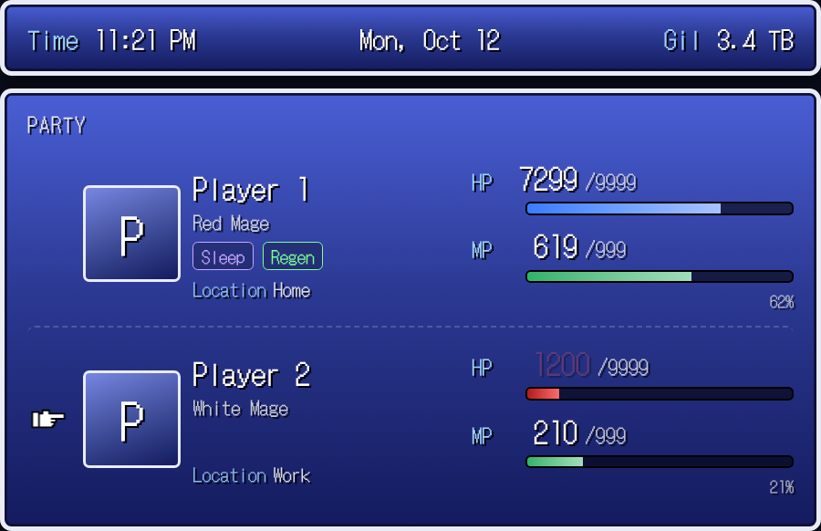
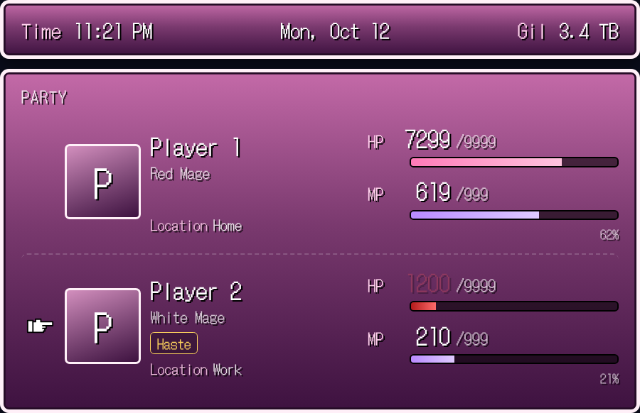

# FF Party Card

A Final Fantasy–style party menu for Home Assistant. Each person in the house is a party member: their phone's battery is their **HP**, another sensor (storage, steps, anything) is their **MP**, and status effects like **Regen**, **Sleep**, and **KO** show what their phone is up to.





## Features

- **HP / MP from any sensor.** Map a sensor's range (say 0–100%) onto FF-style numbers like `7300/9999`.
- **Status effects.**
  - Built in: **Regen** (charging), **Sleep** (night + home + charging or DND), **Silence** (DND / Focus), **Slow** (power saving / Low Power Mode), **KO** (dead or offline).
  - Custom: make your own from any entity, e.g. *Haste* while driving.
- **FF touches.** A bobbing glove cursor points at whoever's lowest, HP turns yellow when low and flashes red when critical, KO'd members go gray, and the time bar shows the time, date, and **Gil** (any sensor you like).
- **Themes.** Six presets plus your own colors, font, and size.
- **Tap / hold actions.** More-info by default, or navigate, call a service, open a URL, and so on.
- **Visual editor.** Everything is configurable without YAML.

## Install

### Manual
1. Copy `ff-party-card.js` to `/config/www/ff-party/ff-party-card.js`.
   If `www` doesn't exist yet, create it next to `configuration.yaml` and **restart Home Assistant** once.
2. Settings → Dashboards → ⋮ → **Resources** → **Add resource**
   - URL: `/local/ff-party/ff-party-card.js?v=1`
   - Type: **JavaScript module**
   (Resources only shows up with **Advanced mode** on in your user profile.)
3. Hard-refresh the browser (Ctrl+Shift+R).

When you update the file, bump `?v=` so browsers don't keep the old copy.

### HACS (custom repository)
HACS → ⋮ → **Custom repositories** → add this repo's URL as type **Dashboard**, then install **FF Party Card**.
For a private repo, the GitHub account HACS is signed in with needs access to it.

## Add it to a dashboard

1. Edit a dashboard → **+ Add card** → search **FF Party Card**.
2. Set up members in the visual editor: name, HP sensor, MP sensor, and any status sensors.
3. For a wall tablet, put it in its own view and set the view type to **Panel (single card)**.

## Phone sensors

Turn these on in each phone's Companion app (on Android most are off by default: Settings → Companion App → Manage Sensors).

| Use | Android | iPhone |
| --- | --- | --- |
| HP | `sensor.<phone>_battery_level` | `sensor.<phone>_battery_level` |
| MP (storage) | `sensor.<phone>_internal_storage` | `sensor.<phone>_storage` |
| MP (steps) | `sensor.<phone>_steps_sensor` ¹ | `sensor.<phone>_steps` |
| Regen | `sensor.<phone>_battery_state` | `sensor.<phone>_battery_state` |
| Silence / Sleep | `sensor.<phone>_do_not_disturb_sensor` | `binary_sensor.<phone>_focus` |
| Slow | `binary_sensor.<phone>_power_save` | read from `battery_state` automatically |

¹ Android counts steps since the last reboot. Wrap it in a daily `utility_meter` to get today's steps:

```yaml
utility_meter:
  android_steps_today:
    source: sensor.<phone>_steps_sensor
    cycle: daily
```

Check the exact entity IDs in Developer Tools → States.

## Configuration reference

Everything here can be set in the visual editor. See [`examples/config.yaml`](examples/config.yaml) for a full example.

### Card

| Option | Default | Description |
| --- | --- | --- |
| `title` | — | Text at the top of the party window |
| `theme` | `classic` | `classic`, `ff7`, `crimson`, `forest`, `midnight`, `moogle` |
| `footer` | `top` | Time bar position: `top`, `bottom`, `hidden` |
| `cursor` | `true` | Point the glove at the lowest HP |
| `gil` | — | Any entity to show as Gil in the time bar |
| `gil_label` | `Gil` | Label for that value |
| `gil_decimals` | — | Round Gil to this many decimals |
| `gil_unit` | `true` | Show the sensor's unit after Gil |
| `hp_label` / `mp_label` | `HP` / `MP` | Bar labels |
| `hp_display_max` / `mp_display_max` | `9999` / `999` | The "out of" number |
| `hp_note` / `mp_note` | `none` / `value` | Text under each bar: `none`, `value`, `percent` |
| `low` / `critical` | `30` / `15` | HP % where it turns yellow / flashes red |
| `sleep_start` / `sleep_end` | `22` / `7` | Hours when Sleep can show |
| `offline_hours` | `6` | KO if nothing reports this long while unplugged (`0` = never) |
| `home_label` / `away_label` | `Home` / `Wandering` | Location text |
| `builtin_statuses` | `true` | Regen / Sleep / Silence / Slow |
| `font` | `dotgothic` | `dotgothic`, `pixelify`, `pressstart`, `silkscreen`, `vt323`, `jersey`, or any CSS font-family you've loaded |
| `font_url` | — | Your own font file (`.ttf` / `.woff` / `.woff2`) or a `.css` stylesheet; overrides `font` |
| `scale` | `1` | Overall size, 0.5–2 |
| `color_window_top`, `color_window_bottom`, `color_border`, `color_text`, `color_label`, `color_hp`, `color_mp` | from theme | Color overrides (hex or `[r, g, b]`) |
| `tap_action` / `hold_action` | more-info / — | Defaults for all members |

### Members

| Option | Description |
| --- | --- |
| `name`, `job` | Name and subtitle |
| `person` | Person entity: location text and portrait picture |
| `image` | Portrait URL, e.g. `/local/ff-party/player1.png` |
| `hp`, `hp_min`, `hp_max` | HP sensor and the values that count as empty / full (default 0–100) |
| `mp`, `mp_min`, `mp_max` | MP sensor and range (default 0–100) |
| `battery_state` | Charging sensor → Regen (and Sleep) |
| `dnd` | DND / Focus sensor → Silence (and Sleep) |
| `power_save` | Power saving sensor → Slow |
| `statuses` | Custom statuses (below) |
| `tap_action`, `hold_action` | Standard Home Assistant actions |

### Custom statuses

```yaml
statuses:
  - name: Haste
    entity: sensor.phone_detected_activity
    state: in_vehicle          # one state or a list
    color: "#ffd45e"
  - name: Berserk
    entity: sensor.phone_battery_temperature
    above: 40                  # numbers: above and/or below
  - name: Float
    entity: binary_sensor.phone_wifi_connection
    attribute: some_attribute  # optional: match an attribute instead of the state
```

With no `state`, `above`, or `below`, the status shows whenever the entity is on.

## Fonts

The default is **DotGothic16**, a free pixel font that's close to the SNES-era Final Fantasy menus. Other presets are in the editor's font dropdown.

To use a font file of your own (for example a fan-made FF font you've downloaded), put it in `www/ff-party/` and set **Custom font file URL** to something like `/local/ff-party/myfont.ttf`. Check the font's license before sharing it.

## Demo

Open [`demo/preview.html`](demo/preview.html) in a browser to play with the card using fake sensors.

## Troubleshooting

- **"Custom element doesn't exist: ff-party-card"**: the resource didn't load. Check the URL and hard-refresh.
- **"Visual editor not supported"**: the browser is still running an old version. Bump `?v=` on the resource and hard-refresh (in the Companion app: Settings → Companion App → Troubleshooting → Reset frontend cache).
- **404 on `/local/...`**: `www` must sit next to `configuration.yaml`, and Home Assistant needs one full restart after it's created.
